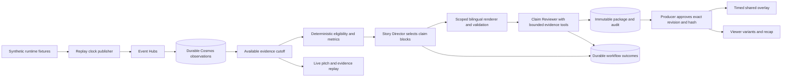

# Architecture and decisions

The producer and viewer share one replay session. Observation availability, deterministic calculations, publication and viewer selection are separate responsibilities. Local mode uses templates and SQLite; the hosted engineering build adds Foundry model roles, Event Hubs, Cosmos and managed identities. See [Azure resources](azure/README.md) and [QA results](qa.md).

## Decisions

- Next.js App Router, TypeScript and original SVG pitch; FastAPI/Pydantic for the API and contracts. Tested versions are pinned, with the npm lockfile and complete Python dependency pins.
- Replay is a wall-clock-to-synthetic-clock mapping stored in SQLite locally and Cosmos in Azure. It releases observations by `available_at_ms`; read tools cannot expand their bound cutoff. Reset creates a new session rather than rewinding approvals.
- A public observation-only catalogue allowlists 171 replays: the original three and 168 expanded cases. Additional streams use deterministic gzip compression. Replay duration follows the selected segment, including 90 s and 180 s sequences. Protected forward jumps pause the replay and release observations through the requested clock; backward navigation requires a new session.
- Source observations are immutable runtime files. Delivered correction messages replace earlier revisions in projections. Source IDs and the contents of all operands contribute to an evidence hash. Canonical hashing treats integral JSON floats and integers equally because Cosmos may serialize `1.0` as `1`; strings, nonintegral values, array order and fields remain significant; changed evidence supersedes current approval.
- Metrics check complete opponent coverage in the trailing window and continuity throughout retention. A receiving outcome alone is insufficient. Evidence coverage and limitations are visible.
- Story packages are immutable SQLite rows locally and Cosmos documents in Azure. Edits create a new package revision, run a single bounded wording review, and invalidate approval. Review requests use the revision/hash actually shown to the producer. Retries use a session-scoped operation ID and request hash.
- Each delivered pass has a separate investigation, `story-<pass-id>` identity, revision stream and editorial decision. Evidence tools bind the selected pass as well as the cutoff. A new pass never supersedes another pass's approval. Corrections invalidate only affected stories. New SQLite tables and Cosmos story pointers preserve legacy single-story records without destructive migration.
- The producer selects reviewed moments independently. Viewers select approved history while the shared overlay remains the latest eligible approved moment. `approved` and `status=expired` are separate: an archived approval is still inspectable/retractable, while its overlay has ended. Recaps combine all currently approved exact story revisions through the requested clock.
- Local mode has no model calls. Version 2 cloud generation uses a Story Director and Claim Reviewer, with bounded evidence requests and one repair. The Director selects supported claim blocks and audience emphasis; a deterministic bilingual renderer binds their actor, values, scope and qualifications. The Reviewer sees the final rendered content and per-claim evidence. The normal path is two model calls, with a six-call/15-second ceiling. Legacy analyst/reviewer/editor packages remain readable, and explicit version 1 generation remains available. A single-agent evaluation comparator gets equivalent tools, renderer and bounded self-review/repair. Model review is fallible; comparative usefulness remains unmeasured.
- All 100 combinations of language, detail and focus are generated before approval: 4 base variants × (general + 22 players + 2 teams). Viewers select stored variants; they never cause model work or acquire editorial permission.
- A viewer-safe snapshot and SSE stream expose approved content only. The protected producer projection adds candidate status and package hashes. Unapproved evidence and diagnostics require the producer key.
- SSE sends an authoritative `resync` snapshot on connection, including reconnect with a last cursor. No durable stream backlog is claimed. Subsequent state updates include full current publication state, so removal/replacement is authoritative. Compression is disabled for stream delivery and the companion reconciles with a snapshot every two seconds as a recovery path.
- Producers poll every 350 ms. Streams coalesce position updates at 250 ms. Each connection holds one snapshot, rather than an unbounded queue. Snapshot cursors combine audit/control sequence and replay time; reset uses a new session ID.
- Recaps are assembled fresh from currently approved revisions through the requested available time. Retraction/edit removes eligibility; the UI invalidates an open recap on story state/revision changes.
- SQLite state survives API restart. In-process locking serializes package creation and decisions; use one API worker. Cloud publication uses ETag-protected transactional Cosmos batches. One API replica remains enforced; distributed scaling is not certified.

## Interfaces and authorization

FastAPI's `/docs` exposes the executable API contract. Producer writes require `X-Producer-Token`. The local default is intentionally public demo access; shared deployment requires a private key or an Entra-authenticated producer identity. Viewer preferences are validated enums/roster IDs, not free-form model instructions.

Use `/studio/{sessionId}`, `/watch/{sessionId}` and `/overlay/{sessionId}`. Next.js proxies `/api/*` to the API host, keeping browser requests on one origin. The web server never includes the producer key in its bundle; the operator enters it and stores it per tab.

## Evidence boundary

`load_match` accepts an allowlist of runtime match IDs and validates metadata/observations. Evidence tools receive server-bound metadata, delivered observations and cutoff; there are no file-reading or arbitrary-query tools. Tool ranges are capped at 15 seconds and 180 observations, with explicit future/range/player errors. Evaluation labels, seeds and configuration names are absent from runtime responses.

Cloud images copy only runtime files, schemas and application code; it must not include `evals` or `data/evaluation-only`. The current developer checkout retains offline evaluation files for reproducibility. The deployed runtime excludes evaluation labels and provenance files. Model tools cannot read arbitrary files or future observations.

## Cloud delivery and failure behavior

The publisher sends only replay-clock-available observations, partitioned by session. The consumer validates immutable session identity and uses batches of up to 100, persisting before Blob checkpoint updates. Exact retransmissions are verified and deduplicated. Periodic durable-cache reconciliation makes rows written by another process visible during rollout. Load balancing is five seconds and ownership expiry twenty seconds; a restart can briefly delay ingestion. These values are demo settings, not a throughput certification.

Model generation runs in two background workers with at most four pending jobs. Polling does not repeat a completed workflow for the same evidence revision. A restart may recompute unfinished work, but durable packages and approvals persist. Changed evidence invalidates old approval before replacement review completes. Models cannot publish.

Jobs are keyed by session, story ID and evidence revision. Out-of-order completion cannot attach a package to another pass, and current evidence is rechecked before storage. New cloud model work is skipped once the original live display interval has expired; already reviewed approved moments remain in history. Completed in-process jobs are bounded to 512 retained entries. This is a bounded demo scheduler, not a production priority/ranking service.

Workflow, role and tool spans carry match/session/revision context and measured usage, excluding prompts, generated prose and credential headers. Cosmos retains the complete bounded review trace. Application Insights sampling is 10 percent; logs also have a workspace ingestion quota. No automated hard spending cap is claimed.

## Contextual iteration: package v3

Default structured generation now uses `context-claims-v3` and `director-critic-v3.0`; configuration values `WHY_NOW_NARRATIVE_VERSION=2` and `=3` select this compatible structured path, while `=1` retains legacy generation. Stored v1/v2 packages keep their hashes/text and are not silently migrated. A rollback must retain this build's v1/v2/v3 readers; deploying an older v2-only reader after v3 writes is not supported.

The aggregate context tool receives the same frozen observations as the current investigation and independently recomputes the latest-three population for review. Director/Reviewer and single-agent evaluation use the same v3 fact catalog and renderer. Angle determines lead order and a constrained bilingual title; producer emphasis uses the same validator. Player focus leads with verified release or reception, with later possession always attributed to the team. Duplicate display names receive team/number disambiguation. Closed rendering prevents arbitrary suggested sentences or unsupported comparison denominators entering published text. The existing six-call/twelve-tool/15-second ceiling remains.

Frontend subscription, preferences, selected variant requests and rendering acknowledgments have focused hooks; evidence replay, inline clause evidence, audience controls, editorial summary and producer editing have separate components. Exact story/revision/preference identities and request cleanup preserve stale-response guards. History starts collapsed. A compact pitch and Show why appear before expanded history and fact details on mobile. Language/focus changes perform read-only projection requests rather than an explicit new model workflow.

SQLite and Cosmos have append-only lifecycle events in addition to immutable workflow outcomes. Delivery dispositions link run/package identity: accepted, stale discard, expiry before acceptance, persistence failure and supersession. Eligible detected opportunities retain first detection, capacity deferral and never-scheduled expiry records. A first browser acknowledgment per approved story revision records a two-animation-frame browser monotonic interval and server receipt time. It has no publication authority, identifies no person, and does not prove reading/comprehension. Server/browser clocks are not subtracted.

This is partial T01 instrumentation: observation durability/evidence readiness are not yet exact UTC stages, expected-but-never-detected opportunities still require the offline reference ledger, restart reconciliation across package commit/disposition append is not atomic, and no end-to-end ingestion-to-display distribution is claimed. Shared API locking and single-worker/replica assumptions remain unchanged; a lock-hold profile and reverse dependency index are pending.

## Editorial iteration: package v4, local version 0.5

New structured generation uses `editorial-claims-v4` and `director-critic-v4.0`. Stored v1/v2/v3 packages retain their approved text/hashes; a rollback requires all four readers. Non-legacy structured configuration selects current v4 generation. `engine/editorial_narrative.py` reuses frozen v3 source/context validation and separately validates its exact new title/clauses/policy. Display rounding does not change raw facts or detection thresholds.

The default editorial policy distinguishes valid comparisons from recommended emphasis; it is provisional and awaits football review. Receiver reception and zone bind to one sentence, and historical distance is not repeated as a separate forward-distance sentence. Producer choices still require an exact new approval. Viewer Return to live changes personal selection only.

Package acceptance and its acceptance lifecycle events now commit together in a SQLite transaction or a same-partition Cosmos batch. Exact retries after a lost response reconcile without republishing. Startup repairs historical missing records only when an exact durable package revision/hash proves acceptance. Recovery records its current wall time and does not invent an original acceptance timestamp.

The matched evaluation supports T3/S3/M3 and evaluator-only D3 reviewer removal. D3 requires `evaluation_only=True`; the application never selects it. Expected opportunities, failures and budget skips remain in denominators. Model outputs and blind human rating packets are retained separately; mechanical checks and model agreement cannot establish user benefit.
