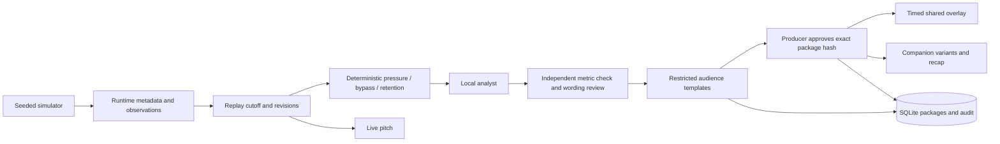

# Local architecture and decisions

The producer and viewer share one replay session. Observation availability, deterministic calculations, publication and viewer selection are separate responsibilities. The current version is a local template MVP corresponding to phase 3 of the supplied technical handoff.

## Decisions

- Next.js App Router, TypeScript and original SVG pitch; FastAPI/Pydantic for the API and contracts. Tested versions are pinned, with the npm lockfile and complete Python dependency pins.
- Replay is a wall-clock-to-synthetic-clock mapping stored in SQLite. It releases observations by `available_at_ms`; read tools cannot expand their bound cutoff. Reset creates a new session rather than rewinding approvals.
- Source observations are immutable runtime files. Delivered correction messages replace earlier revisions in projections. Source IDs and the contents of all operands contribute to an evidence hash; changed evidence supersedes current approval.
- Metrics check complete opponent coverage in the trailing window and continuity throughout retention. A receiving outcome alone is insufficient. Evidence coverage and limitations are visible.
- Story packages are immutable SQLite rows. Edits create a new package revision, run a single bounded wording review, and invalidate approval. Review requests use the revision/hash actually shown to the producer. Retries use a session-scoped operation ID and request hash.
- The local workflow has no model calls. Three typed roles perform deterministic work; the reviewer can request a prior-window check and restore safe wording after a producer edit. This is not evidence that an AI multi-agent architecture outperforms a simpler baseline.
- All 100 combinations of language, detail and focus are generated before approval: 4 base variants × (general + 22 players + 2 teams). Viewers select stored variants; they never cause model work or acquire editorial permission.
- A viewer-safe snapshot and SSE stream expose approved content only. The protected producer projection adds candidate status and package hashes. Unapproved evidence and diagnostics require the producer key.
- SSE sends an authoritative `resync` snapshot on connection, including reconnect with a last cursor. No durable stream backlog is claimed. Subsequent state updates include full current publication state, so removal/replacement is authoritative. Compression is disabled for stream delivery and the companion reconciles with a snapshot every two seconds as a recovery path.
- Producers poll every 350 ms. Streams coalesce position updates at 250 ms. Each connection holds one snapshot, rather than an unbounded queue. Snapshot cursors combine audit/control sequence and replay time; reset uses a new session ID.
- Recaps are assembled fresh from currently approved revisions through the requested available time. Retraction/edit removes eligibility; the UI invalidates an open recap on story state/revision changes.
- SQLite state survives API restart. In-process locking serializes package creation and decisions; use one API worker. Distributed concurrency requires a transactional Cosmos adapter before scaling.

## Interfaces and authorization

FastAPI's `/docs` exposes the executable API contract. Producer writes require `X-Producer-Token`. The local default is intentionally public demo access; shared deployment requires a private key or an Entra-authenticated producer identity. Viewer preferences are validated enums/roster IDs, not free-form model instructions.

Use `/studio/{sessionId}`, `/watch/{sessionId}` and `/overlay/{sessionId}`. Next.js proxies `/api/*` to the API host, keeping browser requests on one origin. The web server never includes the producer key in its bundle; the operator enters it and stores it per tab.

## Evidence boundary

`load_match` accepts an allowlist of runtime match IDs and validates metadata/observations. Evidence tools receive server-bound metadata, delivered observations and cutoff; there are no file-reading or arbitrary-query tools. Tool ranges are capped at 15 seconds and 180 observations, with explicit future/range/player errors. Evaluation labels, seeds and configuration names are absent from runtime responses.

A future cloud container must copy only runtime files, schemas and application code; it must not include `evals` or `data/evaluation-only`. The current developer checkout retains offline evaluation files for reproducibility. There is no container deployment or model sandbox to claim as verified yet.
