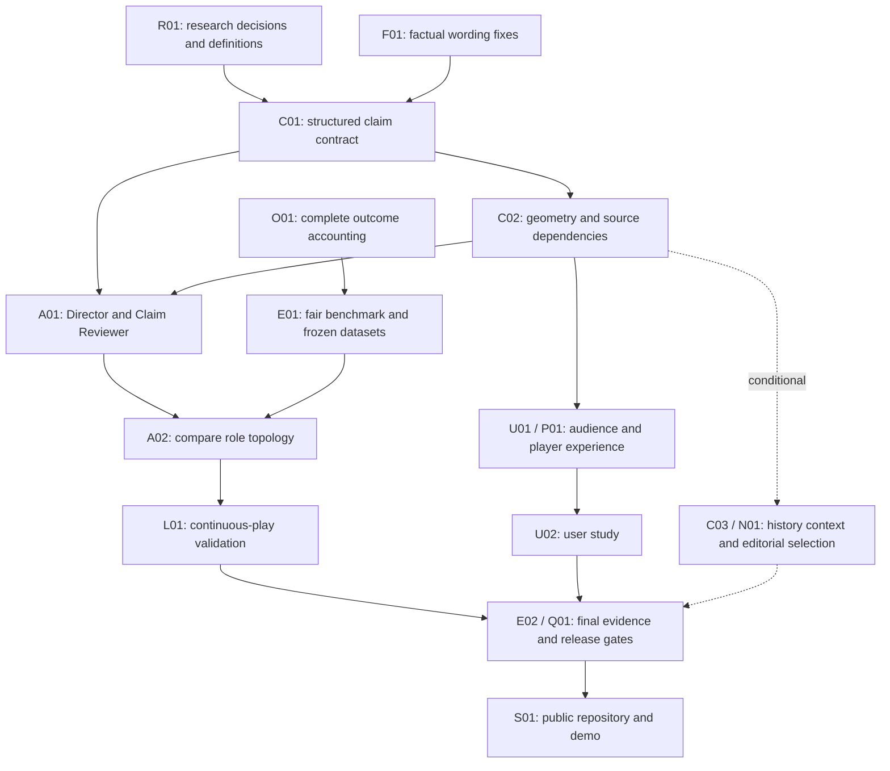

# WHY/NOW — Grand Prize improvement plan

> **Current product handoff:** [90+ product improvement plan](grand-prize-90-plus-plan.md), based on version 0.4 and the latest 76/100 assessment. It covers the MVP only and supersedes the next-iteration scope below. The original version 0.3 plan is retained here as historical context; current delivery is tracked in [the implementation record](decision-log.md).

**Prepared:** 21 October 2026, America/Lima. **Baseline:** `e62c043` / API 0.3.0, cloud-v13 / web cloud-v7. **Status:** researched engineering handoff; product changes below are not implemented. **Owner:** James. Target the first-place Grand Prize through a more useful, convincing end-to-end product.

## Read this first

WHY/NOW already has a functioning Azure pipeline and unusually careful publication controls. The next iteration must make the football explanation more useful, demonstrate why its agents are helpful, and prove that people can use it while play continues. Additional cloud services or more agents are not success criteria.

The intended experience is: **a producer notices a meaningful forward passage, understands what changed from visible evidence, approves a concise explanation, and delivers different useful views to a casual fan and an analyst.** A selected player changes which approved moments and evidence the viewer sees. The system can remain quiet, qualify a claim, and withdraw a corrected story.

This handoff contains:

1. [Agent evaluation](agent-evaluation.md): completed code/trace review, new reproducible offline probes, agent changes and architecture decision.
2. [Research and decisions](research-decisions.md): primary sources, what they support, remaining research spikes and explicit non-goals.
3. [Engineering backlog](engineering-backlog.md): ordered tickets with scope, dependencies, files, tests, effort and exit conditions.
4. [Evaluation and user research](evaluation-plan.md): fair comparisons, fresh datasets, scoring, timing, budgets and participant tasks.
5. [Machine-readable audit evidence](evidence/agent-audit.json) and [offline reproducer](evidence/audit_probe.py).

## What the current assessment means

The earlier 71/100 assessment is an internal judgment, not a calibrated prediction. Every criterion carries 20%. The target below describes evidence that would justify reassessing it; there is no guarantee of a prize or an exact score increase.

| Criterion | Current internal score | Next-iteration evidence to earn a stronger assessment | Main tickets |
|---|---:|---|---|
| Technology | 16/20 | All workflow outcomes accounted for; compatible claim contracts; live timing and correction/recovery checks; reproducible CI and public source | F01, O01, C01, L01, Q01, S01 |
| Agentic design | 12/20 | Agents choose supported explanatory content; reviewer changes a consequential decision; measured comparison against a strong single agent | E01, A01, A02, E02 |
| Impact | 12/20 | Producer and viewer tasks observed with relevant participants; useful output before expiry; explicit pilot fit and operating costs | L01, U02, E02 |
| UX/presentation | 14/20 | Immediate explanation/evidence connection; visibly different audience views; relevant player history; clear working demo | U01, U02, P01, S01 |
| Category fit | 17/20 | Meaningful context and personalization throughout the existing five-stage pipeline; coherent recap; complete submission | C02, C03, P01, N01, S01 |

## Facts established before proposing features

- At this baseline, the backend suite passed 196 tests; recorded verification includes nine local browser tests, live Azure publication/retraction and a replica restart. These are engineering checks, not user validation.
- The 168-case, 594-checkpoint synthetic result used templates and zero model calls. Its six inspected parent configurations are regression material, not a fresh blind benchmark.
- The final recorded three-moment Azure run made 14 real model calls and used 17,279 reported tokens: two AI-composed packages, one explicit template fallback. Workflow times were 17.260 s, 11.013 s and 15.863 s, excluding ingestion and human approval. This sample cannot establish P95 latency or an AI success rate.
- The completed agent audit found two correctness/accounting issues: player-focused text can confuse receiver possession with team possession; abstentions return no package and disappear from package-based usage totals.
- Offline adversarial probes confirmed that unsupported free text can survive existing code checks if a fake semantic reviewer accepts it. These were deliberately controlled tests, not observed real-model failures or public publication events.

See [agent evaluation](agent-evaluation.md) and the existing [QA record](../qa.md) for provenance and limits.

## Product scope and decisions

### Commit to these improvements

1. Correct actor attribution and replace misleading football terminology.
2. Record an outcome for every attempted workflow, including rejection, timeout and abstention.
3. Introduce structured claims and narrative plans so each displayed factual clause has the right evidence, scope and qualification.
4. Test a compact **Story Director → Claim Reviewer** workflow. The Director combines selection and audience composition; the Reviewer checks final content. A separate Audience Composer is an experiment only if the two-role version cannot meet quality goals.
5. Add exact forward pass displacement and reception zone. These improve the explanation using existing observations without claiming tactical causality.
6. Improve casual/analyst views and player-focused approved history, using the current evidence replay and publication rules.
7. Run a fair agent comparison, continuous-play checks and a small formative user study before making improvement claims.
8. Publish the source and final demonstrated evidence; complete the submission package.

### Conditional additions

- A real previous-pass comparison tool, if new sequences contain enough delivered history and the context passes football review.
- Transparent editorial priority/cooldown and a more concise recap, if tests show a better result than chronological ordering.
- An optional deterministic candidate available before AI completion, only if latency work fails and exact approval/version behavior is fully specified and tested.

### Defer

Shots/xG, tactical intent, defensive-unit line-break detection, calibrated pressure probability, full-match simulation, speech, more languages, CV, a generic chatbot, autonomous publication, new cloud services, hosted-agent migration, and broad enterprise identity/scaling work. Each creates a new validation or integration project. Revisit after submission or after the core gates are met.

## Invariants the engineer must preserve

- Runtime data contains no future observations, hidden scenario labels, seeds or reference answers.
- Metrics remain deterministic. Models select and explain supported information; they do not manufacture measurements or control publishing.
- Producer approval binds the exact package, evidence, story and revision. Any changed text or evidence requires a fresh approval; an AI completion cannot silently replace approved text.
- Corrections, expiry, retraction, archived selection and recaps remain isolated per story. A contextual claim also depends on its historical source observations, so historical corrections can invalidate dependent packages.
- Viewers cannot see unapproved candidates or protected diagnostics and never trigger per-viewer model calls.
- Keep the existing 168-case regression intact. Add new parent configurations; do not rewrite old expectations to conceal failures.
- Old saved packages remain readable. Do not rewrite approved historical content in place. Schema, prompt, metric, model and renderer versions belong in the release manifest.

## Sequence and dependencies

## Delivery schedule and capacity

The official submission deadline is **28 October 2026, 01:59 Lima** (27 October, 23:59 Pacific). Aim to finish submission checks on **27 October at 18:00 Lima**. Registration has already closed; James must verify that the team is registered. [Official rules](https://github.com/microsoft/insidethegamehackathon/blob/main/OFFICIAL%20RULES.md)

The recommended core is approximately **70–100 engineering hours**, including evaluation and release work, plus **8–12 hours of product/research participation and recording**. Estimates assume the existing developer environment and two experienced engineers sharing backend/evaluation and frontend/release responsibilities. Conditional items add approximately **15–25 hours**. These are planning estimates with substantial uncertainty; revise after R01/E01. Parallel work requires an agreed schema and test fixtures first.

| Lima date | Backend / evaluation | Frontend / delivery | Owner / research | Exit condition |
|---|---|---|---|---|
| Oct 21 | R01, F01, O01; preserve baseline | Inspect current UI; prepare U01 states and publication access | Confirm registration; arrange participant availability | Findings and instruments agreed; no new feature assumptions hidden |
| Oct 22 | C01, E01 discovery harness and parent split | U01 implementation against stable contract | Pilot one study session; football wording review | Versioned contract and working benchmark smoke |
| Oct 23 | C02, A01 | U01/P01 integration | Review narrative prototypes | Supported, non-generic explanations working locally |
| Oct 24 | A02, L01; decide whether C03 fits | P01 and optional N01 | Begin formative sessions on stable build | Architecture chosen; any optional feature either accepted or cut |
| Oct 25 | E02 final evaluation, Q01 corrections and cloud checks | Fix observed UX failures, finish accessibility checks | Complete sessions and verify findings | No new feature scope after this date; candidate release frozen |
| Oct 26 | Resolve release blockers; deploy frozen candidate | S01 CI, public-read rehearsal, record working application | Approve factual submission wording; narration | Release evidence and usable video draft |
| Oct 27 | Only fixes for demonstrated blockers | Final export and link/access verification | Submit before 18:00 Lima target | Submission complete with buffer |

**One-engineer fallback:** keep F01, O01, a minimal C01/A01 implementation, U01, E01/E02, L01, Q01 and S01; use existing facts and ship player history only if time remains. Defer C02/C03/N01 if they threaten verification. Budget roughly 45–60 hours and disclose a smaller evaluation if necessary. Never cut factual checks, approval tests or submission packaging to add a feature. If this reduced scope is still too large, preserve the current role flow with corrected wording and complete the strongest available evaluation/UI improvements.

## Release gates and stop decisions

Thresholds below are proposed project targets, not current results or externally established standards. Freeze them before evaluating the final set.

| Gate | Required evidence | If it fails |
|---|---|---|
| G1: Publication correctness | Zero tested unapproved, stale, cross-story, future-source or retracted content leaks; compatible old packages | Block deployment; fix or disable the new capability |
| G2: Claim correctness | Every rendered clause has valid scope/bindings; zero severe unsupported claims in the final reviewed set; report sample size and all lesser issues | Use supported structured rendering; remove offending feature; final set becomes regression after tuning |
| G3: Accounting | All scheduled/started attempts produce terminal outcome or explicit interrupted status; unknown usage is never counted as zero | Do not publish cost/quality aggregate until reconciled |
| G4: Agent value | Paired comparison shows useful improvement or a clear quality/latency tradeoff; all arms and fallbacks reported | Ship the simpler passing design; do not claim multi-agent superiority |
| G5: Live suitability | Target candidate-ready P95 ≤10 s after durable evidence readiness at one stream, ≥90% of eligible stories ready with ≥10 s remaining; measure two-stream degradation | Optimize; evaluate labeled factual-first path; otherwise describe replay-assisted workflow honestly |
| G6: Audience usefulness | User tasks expose no unresolved critical misunderstanding or publication mistake; observed benefits and failures retained | Fix and retest the affected task; do not claim broad ROI |
| G7: Submission | Public CI-backed source, functioning <120 s video, truthful description, working judge access and release manifest | Submission is incomplete; feature work stops |

## Engineer's first actions

1. Read the linked evaluation and backlog; verify working tree and baseline commit.
2. Create the iteration branch and an issue/checklist for each selected ticket. Avoid combining schema migration, agent redesign and UI changes in one commit.
3. Implement F01/O01 first; then lock C01 and E01 before agent tuning.
4. Maintain a decision log with discovered facts, experiment results, removed scope and release status. Mark work complete only with linked evidence.
5. Before running billable evaluations, calculate the bounded run estimate using current deployed-model rates and set the run's token/call/cost limits. No additional Azure services are required by this plan.

Owner-dependent work: registration confirmation, GitHub repository ownership/publication and license choice, participant recruitment/consent, independent football review, and final submission. These are explicit dependencies; no participant results, registrations or publications are assumed completed.
