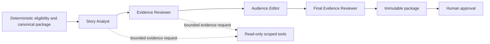

# Agent evaluation and proposed changes

Assessment date: 21 October 2026. Source baseline: `e62c043676f0083cb5e4808547c63292c3aad7a8`. Selected application source: `engine/`; execution environment: the existing Azure Container Apps API using the Foundry model deployment. This is an application-owned Agent Framework workflow, not a hosted Foundry Agent Service agent. No hosted-agent evaluation suite or remote evaluation metadata is claimed to exist.

## Evaluation performed

This review inspected source code, existing unit tests, documented regression outcomes, recorded Azure model attempts and the deployed viewer output. It also ran new offline adversarial fake-provider probes. No new paid model evaluation, human study, model comparison or Azure change occurred during this planning work. The skill's hosted-agent batch workflow is not being represented as having run.

The offline probes are reproducible against the recorded baseline with the command below. After the workflow changes, convert these cases into regression tests for the new contract; do not overwrite this historical audit to imply the old implementation behaved differently.

```sh
.venv313/bin/python docs/next-iteration/evidence/audit_probe.py
```

Recorded results: [agent-audit.json](evidence/agent-audit.json). The fake provider deliberately approves unsupported text to test the application boundary. Its artificial usage values are not real token consumption. No probe publishes anything.

## Current workflow



It normally uses at least four model calls, with additional calls for evidence or repair. The agents use separate contexts on the same model deployment. They are not statistically independent fact checkers. Producer-proposed text reaches both the Analyst and the first Reviewer as untrusted input; this is instruction separation, not a blind factual assessment.

## Findings and required response

| ID | Finding | Evidence | Priority and response |
|---|---|---|---|
| AEF-01 | Receiver wording attributes team retention to an individual | `engine/workflow.py:59`; `engine/core.py:80` checks `possession_team_id` | P0 F01: say receiver received; team retained. Test onward possession within the three-second interval. |
| AEF-02 | Numeric/schema checks cannot establish free-text truth | Both false introductions in the offline probe survive if a permissive fake reviewer accepts | P0 C01: type the supported predicates and relations, bind clauses to claims, validate before and after composition. Human review remains required. |
| AEF-03 | Abstention/rejection usage disappears from package-based accounting | `engine/foundry_workflow.py` returns `None` before attaching usage; API stores/logs only a returned package; fake abstention calls provider once but returns no outcome | P0 O01: persist WorkflowOutcome independently of PublicationPackage. Existing per-call telemetry is not equivalent to complete outcome accounting. |
| AEF-04 | Final AI text is primarily a generic introduction | Editor limited to ≤25 words without names/numbers; `expand_and_validate` appends canonical facts | P0 A01: give the model meaningful claim selection and audience organization; remove decorative introduction requirement. |
| AEF-05 | Prior-window tool cannot compare history | `EvidenceTools.compare_prior_window` always returns insufficient history | C03: implement an aggregate comparison with explicit scope, or remove the misleading capability from the tool menu. |
| AEF-06 | Player contribution is only a role lookup | `get_player_contribution`; generated focus suffix | P01: expose supported participation and approved history; no invented off-ball value. |
| AEF-07 | Claim IDs are coarse and over-inclusive | All variants cite all four claims; contract verifies reference membership, not clause support | C01: clause-to-claim and entity-role bindings, plus exact dependencies and qualifications. |
| AEF-08 | Multi-agent benefit is unmeasured | No fair single-agent benchmark; 168-case suite has zero model calls | E01/E02: paired outcome and process evaluation with a strong baseline. |
| AEF-09 | Latency sample is too small for live guarantees | Three recorded outcomes: 17.260 s, 11.013 s fallback, 15.863 s | L01: record queue/ingestion/model/render/human time separately under continuous play. |
| AEF-10 | Reviewer cannot prevent all unsupported phrasing | Recorded editor repeated key-pass wording after repair; fallback contained it. Historical Spanish opportunity wording triggered a fix | A01/E02: adversarial semantic cases, final rendered-text review and evidence-preserving fallback. Do not claim hallucination elimination. |

The two false probe introductions were “The pass split the defensive line and left the defence exposed.” and “The pass failed and possession was lost.” The second contradicts `retained=True`. These demonstrate a **possible application failure when semantic review is wrong**, not a real-model failure rate. Publication still requires the producer.

Existing real-run summary comes from `.run/cloud-multi-smoke.json`, SHA-256 `6599c05eddf3ddc0e9c6b9f9286dbb4ee594078eaa7480d61023dab0c0c00da7`; guard diagnostics SHA-256 `ecaff8b20488370ed16544af0d2933f569de53d5a77a32dfd3852582411d9179`. These local files are ignored and are not required for a public clone; the nonsecret measured results are reproduced in [QA](../qa.md). Do not copy credentials or entire private diagnostic folders into the repository.

## Candidate architecture: evaluate two roles first

The default experiment combines Analyst and Audience Editor responsibilities in a **Story Director**, then uses a **Claim Reviewer** to check the final proposed package. This reduces serial handoffs while making the first role choose useful content. It is a hypothesis to test against a three-role alternative and a strong single agent; it is not a conclusion that fewer calls are inherently better.

| Component | Allowed decisions and output | Tools / authority | Evaluation question |
|---|---|---|---|
| Deterministic evidence builder | Eligibility, exact measurements, coverage, source/version dependencies, allowed factual predicates | Delivered observations only | Are facts and cutoffs correct under correction, missingness and mirrored direction? |
| Story Director: updated Analyst + Editor | `propose`, `needs_evidence`, `abstain`; selects an angle and ordered claim blocks for four language/detail views; proposes relevant player/team selections | `get_claims`, `get_sequence`, `get_positions`, scoped contribution; optional recent-pass comparison | Does it select concrete useful facts without adding unsupported relations or filler? |
| Claim Reviewer: updated Reviewer | Per-clause supported/unsupported/insufficient verdicts; names offending relation/span and evidence; may request one bounded evidence batch or one repair | Can independently retrieve/recompute claims; cannot mutate them or approve publishing | Does it catch actual scope/meaning errors, and does its intervention improve outputs? |
| Deterministic renderer/validator | Resolves entities, measurements, units, qualifiers and supported lexical forms; rejects unbound or forbidden semantic relations | No model authority; all audience variants checked | Can a permissive model reviewer bypass actor, time, polarity or comparison constraints? |
| Producer | Approve exact rendered package, propose edits, suppress/retract | Existing protected publication APIs | Can the person verify and act before expiry? |

### Typed outputs to design in C01

- `EvidenceClaim`: stable claim ID; predicate; subject/entity IDs; value/unit where relevant; observation window; availability cutoff; coverage; source IDs; metric version; uncertainty/limitation; evidence revision. Comparison claims include comparator IDs, denominator and source dependencies.
- `StoryPlan`: story/evidence IDs; `angle` from an allowlist; ordered claim IDs; audience block selections; supported relations; actor focus; reasons to show/withhold; requested evidence. A reason is an editorial rationale, never a confidence percentage.
- `ClaimVerdict`: clause ID; verdict; exact claim/source IDs; offending span/relation; repair code. No unsupported claim becomes valid merely because the reviewer says supported.
- `AudienceBlock`: language/detail/focus, claim bindings and approved lexical choices. Numerals and names resolve from facts. Default to bounded semantic templates and model-selected organization; broader prose is a later experiment, not required for the demo.
- `WorkflowOutcome`: run/session/story IDs, terminal state, attempt/step metadata, provider usage including incomplete values, timing and package reference if one exists. Outcomes survive when no story is produced.

The model must materially affect selection, ordering or audience emphasis; choosing a decorative preamble is not sufficient. Independent review must be able to reject a misleading selection, even if every individual number is correct. Example: comparing only favorable earlier passes while omitting an in-scope larger pass is unsupported comparative framing.

### Handoffs, limits and failures

Normal path: Director → deterministic realization/validation → Reviewer → immutable package. Reviewer sees the exact final proposed audience text and bindings, plus independent facts; it does not rely on Director reasoning as evidence. On repair, regenerate and validate, then review the new final text. All 100 current focus combinations must remain covered, or a deliberately versioned replacement contract must define supported combinations and empty states.

Suggested experiment bounds: normal two model calls; at most one evidence-return continuation per role, one repair plus re-review, **six calls total**, twelve read-only tool calls and a shared deadline/token ceiling. Enforce the global ceiling even when individual permissions allow more steps. Cache only by complete source, renderer/prompt/model version and audience identity. Stale completion never publishes. Cancellation/rejection remains a terminal outcome.

Retain current production mode behind a reversible configuration choice during experiments. Do not silently route difficult cases away from the benchmark. An optional third Audience Composer is worth retaining only if improved comprehension/translation quality compensates for added latency/cost. Keep existing SDK pins unless a concrete capability requires a tested update; using a graph builder solely to change the diagram is unnecessary.

The deterministic scheduler owns deadlines, deduplication, job persistence, cache identity, publication state and retry limits. No new manager/scout/recap agent is planned by default.

## Decision rule

Use [evaluation-plan.md](evaluation-plan.md). Assess supported usefulness and reviewer contribution, not agent count or fluent text. If the single agent meets the same quality gates with materially lower latency/cost and the collaboration gain is inconclusive, ship the simpler configuration and report that result. The Grand Prize target rewards the complete product; it does not justify an unsupported multi-agent claim.
